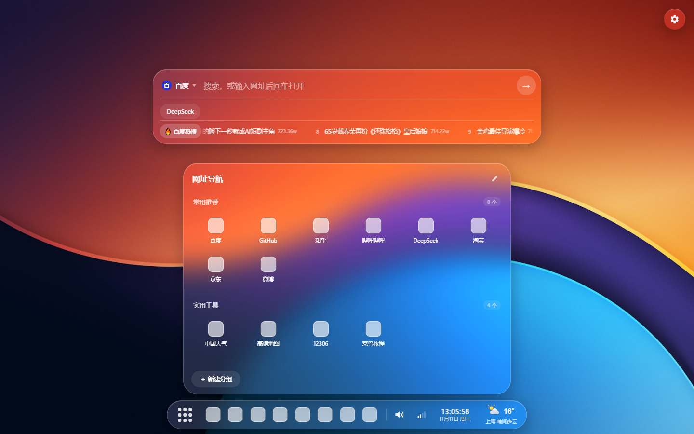

# Atrium Nav · 玻璃拟态网址导航

一个**单文件**的液态玻璃（Liquid Glass）风格浏览器起始页 / 网址导航页 —— `index.html` 一个文件装下全部逻辑，双击即用，无需安装、无需后端。

> 本项目的设计灵感与部分代码来自 [wynter-yaxley/atrium-desktop](https://github.com/wynter-yaxley/atrium-desktop)（C# 桌面玻璃美化项目），在此向原作者致谢 🙏 —— 本仓库将其玻璃视觉语言移植成了纯 Web 实现，并做了大量导航场景的适配。

## ✨ 功能

- **玻璃搜索框**：可切换/自定义搜索引擎（百度 / Bing / Google / 搜狗 / 360 / 哔哩哔哩内置）
- **搜索历史**：最多 9 条，支持单条删除、暂停与清空
- **直达网站**：快捷入口行，可自由增删（默认 DeepSeek）
- **百度热搜**：实时滚动热榜，悬停放大，明暗主题自适应
- **网址导航面板**：分组管理、跨分组移动、批量编辑、单条 Logo 自定义（自动抓取 favicon / 上传图片 / 首字兜底）、一键清除全部网址
- **图标本地落盘**（v1.5）：「一键获取 Logo」成功后自动转存为本地 PNG，离线可用、永不过期；首字图标同样生成一次 PNG 落盘，不再依赖外网
- **任务栏图标数量一键应用**（v1.5）：设置里的 ↻ 按钮即点即生效，不用回车
- **一键导入浏览器收藏夹**：支持 Chrome / Edge 的 `Bookmarks` 文件与导出的 `bookmarks.html`，自动识别浏览器并给出文件路径
- **任务栏**：访问量 Top-N 图标（数量可调）、悬停波浪放大（倍数可调）、音量/网络信号托盘图标（可开关）
- **时钟与天气**：秒级时钟 + 实时天气（Open-Meteo，自动定位，多源兜底）
- **日出日落图示**（v1.41）：悬停时钟弹出天弧图 —— 太阳按当前时刻沿弧线移动，昼蓝 `#3B82F6` / 夜黑 `#0B1026` 渐变背景随晨昏流动，含昼长与日出日落倒计时；日落后显示「当日日落 → 次日日出」夜弧与月相（v1.5.1）
- **设置面板滚动条**（v1.5.1）：滚动条收在圆角安全区内，不再上下出头
- **访问量角标开关**（v1.5.1）：设置里可显示/隐藏网址导航的访问量小徽章，默认关闭
- **热搜拖拽**（v1.5.2）：百度热搜跑马灯支持鼠标按住左右拖动，松手带惯性滑行、指数阻尼减速，停稳自动恢复滚动；轻点仍可直接打开新闻
- **热搜体验修补**（v1.5.3）：修复每圈回卷时的 15px 跳变卡顿（循环周期改按内容节点精确测量）；点「🔥百度热搜」标签直接新标签页打开热搜榜
- **昼夜按日出日落切换**（v1.5.3）：昼/夜不再按自然日切分 —— 抓取昨天/今天/明天三天日出日落，夜间段从日落连续覆盖到次日日出（自然跨过午夜），凌晨也能看到夜弧与月亮；背景渐变、倒计时、昼长同步按事件计算
- **热搜榜多选**（v1.5.4）：设置里可勾选最多 3 个热搜榜（百度 / 微博 / 抖音 / 今日头条 / 知乎 / B站 / 豆瓣 / 36氪·虎嗅 / 今日热榜），多榜合并滚动并带来源徽标；三镜像并行抓取，30 分钟自动刷新
- **热搜样式精修**（v1.5.4）：深色壁纸下标题提为纯白加粗；前三名序号改为白字红圆底徽标
- **一键获取全部 Logo**（v1.5.4）：分组编辑底部新增「⤓ 一键获取 Logo」，为整组没有 Logo / 首字图标的网址批量抓取（失败自动落首字图标）；自定义上传/粘贴的图标一律跳过，旧版 64×64 首字 PNG 也能识别重取
- **收藏夹获取支持 360 浏览器**（v1.5.4）：自动识别 360 极速（含极速X / 旧版）与 360 安全浏览器；任何浏览器打开都可在弹窗里复制 360 收藏夹路径或按指引导出 HTML
- **编辑不再丢改动**（v1.5.5）：编辑途中删除/上移/下移/移动网址时，行内已改但未保存的名称与网址会先收集再重排，不再被旧值覆盖；编辑中面板意外关闭也会自动保存
- **修复删除行闪退**（v1.5.5）：删除记录后面板不再整块关闭，改为原地减少一行继续编辑
- **分组排序**（v1.5.5）：分组可 ↑ ↓ 逐个换位；底部新增「⇅ 分组排序」，弹窗里按住拖动即可一次性调整全部分组顺序
- **组内拖动排序开关**（v1.5.5）：分组编辑底部新增「拖动排序」开关（默认关闭）；打开后网址行首出现 ⠿ 手柄，可按住在本组内自由拖动换位，松手即保存，跨组不生效
- **移到弹窗重制**（v1.5.5）：原生下拉改为玻璃风格弹层（显示各组网址数），点弹窗外部即关闭；滚动条与全局统一并收在圆角内
- **分组名称支持 8 个字**（v1.5.5）：编辑与新建分组均可输入最多 8 个字
- **分组标题更醒目**（v1.5.5）：分组标题字号增至 15px 并叠一层淡阴影，在彩色壁纸上更清晰易读；网址图标名不受影响
- **设置弹窗改为顶端滑下**（v1.5.6）：设置窗体从页面顶端中间缓缓滑落至屏幕居中（0.62 秒），落定带回弹（强度为全局弹性曲线的 2/3）
- **网址导航橡皮筋回弹**（v1.5.6）：分组面板滚到最顶/最底还继续滚动时，内容被拉动拉伸（阻尼上限 17px），停止滚动后弹回原位，iOS 式 overscroll 手感；普通滚动不受影响
- **设置面板同款橡皮筋**（v1.5.6）：设置窗体滚动也获得与导航面板完全一致的顶/底拉伸回弹手感
- **新建分组收进编辑态**（v1.5.6）：普通状态不再显示「＋ 新建分组」按钮，底部工具条整体仅编辑态显示；滚动条上下各收 26px 安全区，与面板圆角对称
- **修复上传 .ico 图标闪退**（v1.5.7）：原生文件对话框关闭瞬间的“幽灵点击”会误关编辑面板并丢失上传上下文，导致图片传不上；现已加对话框守卫拦截，并放行 .ico 等图片扩展名
- **日出日落面板夜间弧线修正**（v1.5.7）：月亮移动方向与标签时间流对齐（日落→下次日出，左→右）；已走过的弧线用实线表示（与日弧同款样式）；弧线在月亮处自动断开不再遮住月牙
- **窗体滚动橡皮筋开关**（v1.5.8）：设置新增「滚动特效」小节，可整体开关所有窗体（导航/设置/历史/移到/分组排序弹层）的顶/底拉伸回弹手感，热搜除外；历史列表与移到弹层本次起也支持橡皮筋；默认开启
- **修复长名称磁贴溢出**（v1.5.9）：导入的长名称网址不再把磁贴撑出面板——磁贴恢复六列均分，过长名称自动省略号截断
- **滚动条改用标准属性**（v2.0.0）：滚动条换用标准 `scrollbar-width` / `scrollbar-color`，Chrome 121+、Firefox、新 Safari 走系统 thin 档渲染（颜色仍由主题变量给出）；旧浏览器由 `@supports` 兜底保留原 8px 自定义样式，零回归
- **输入法安全回车**（v2.0.0）：搜索框、图标网址输入、缩放输入、壁纸色值输入四处回车监听加输入法组合守卫，中文选词按回车不再误触发搜索/应用
- **减少动态效果适配**（v2.0.0）：系统开启「减少动态效果」时自动收起全部过渡动画与橡皮筋拉伸，弹窗改为瞬间出现，照顾前庭敏感用户
- **Esc 逐层关闭浮层**（v2.0.0）：按 Esc 从最上层浮层（图标弹层 → 移到 → 分组排序 → 引擎菜单 → 设置 → 导航面板）逐层退出，一次只关一层
- **无障碍标签**（v2.0.0）：全部图标按钮补齐 aria-label；任务栏图标带名称供屏幕阅读器朗读；网络/时钟托盘可键盘聚焦
- **数据三重保险**（v2.0.0）：每次保存前自动把上一版留底，「⟲ 恢复最后一次成功加载的配置」可随时回退误删误改（再点一次即切回）；本地数据损坏时先原样存档再按默认启动，不覆盖证据；启动检测到「上次有数据、这次读不到」（浏览器崩溃/清理所致）时弹警示提醒先恢复再动手
- **修复：导入旧备份后分组被起步包覆盖**（v2.0.1）：旧版导出的配置不含预设标记，导入后下次打开会误触发「百度我的常用」预设迁移，把分组整包替换（两次数据丢失事故的根因）。现在导出配置带上该标记、导入旧备份自动视为已迁移、预设迁移加一次性标记三重防护，同类覆盖不可能再发生
- **站立活动倒计时**（v2.1.0）：无边框毛玻璃悬浮窗（约 10% 页宽），可拖动摆放；「距离起立还有」「距离坐下还有」两段轮流执行，时分秒计时显示，时长在设置中分别调整（分钟数或「分:秒」）；开关关闭时不计时
- **提前完成确认**（v2.1.0）：时间未到点击倒计时窗会询问「你要提前完成这个阶段吗？」——确认切换、取消则继续当前计时；超时后负数计时（红字＋抖动），点击直接进入下一段
- **到时放大提醒**（v2.1.0）：设置开关开启后，倒计时归零瞬间窗体放大 300% 居中全屏并抖动，点击后恢复原大小并精确回到原位（默认关闭；系统开启「减少动态效果」时不抖）
- **倒计时系统提醒**（v2.1.1，v2.1.2 调整，v2.1.3 补文档）：设置开关开启后，到点时标签页标题交替闪烁，并弹 Windows 系统通知（首次需授权一次，拒绝授权不影响标题闪动）；每段只提醒一次，切段或关闭即停。v2.1.2 起不再改动站点 favicon（浏览器标签页通常不刷新、钉选任务栏也不会同步），保留更可靠的标题闪烁＋系统通知＋页面内提示。设置面板内实时显示系统通知授权状态（已授权／被浏览器阻止／未授权／授权未完成），并提供独立「授权系统通知」按钮——首次授权被拒或失败后可点此按钮补做授权（被浏览器永久阻止时给出地址栏锁图标的放行指引）
- **日历计划任务**（v2.2.0）：右下角日历图标（带未完成数角标），点击后毛玻璃窗体从下往上滑出——贴在右侧、位于图标正上方，宽 23vw、高 70vh。可新增文本记录（上限 500 字、置顶显示记录时间），按时间一键切换排序；圆形按钮标记完成（移入已完成）、减号删除。「一键完成所有」批量完成；「已完成计划管理」全屏居中弹出，可取消完成回退、一键清除全部。数据随配置导出/导入，Esc 逐层关闭，系统「减少动态效果」时无动画
- **日历窗体悬停预览**（v2.2.5）：鼠标停在右下角日历图标上时，计划任务窗体临时滑出预览，移开自动收起（含 12px 间隙延时，鼠标移到窗体上保持不收）；点击固定打开、关闭按钮、Esc 等原有行为完全不变；触屏设备仍走点击
- **多倒计时**（v2.2.5）：设置开关开启后，浮窗内逐条添加「名称＋时长」（分钟或「分:秒」），浮窗随条目数增高、可拖动摆放；每条有笔图标编辑、环形箭头重置、暂停/继续图标。新增后立刻开始计时；关闭窗体（总开关）时所有倒计时时间重置为原始时长并暂停，下次打开不立刻走时、点 ▶ 才开始；计时到点时原浮窗不动、另弹居中放大 300% 抖动提醒窗体（可关「到时放大提醒」），点提醒窗或点到时条目本体即进入「已停止」态（冻结负数、停抖）；系统提醒开关开启后到点标题闪烁＋Windows 通知（授权状态显示在设置内，可补授权）。数据随配置导出/导入，Esc 逐层关闭
- **站立倒计时暂停/继续与重置**（v2.2.6）：站立活动倒计时悬浮窗新增 ⏸/▶ 暂停继续与 ↻ 重置图标按钮——暂停冻结当前剩余（停抖、退出放大、停提醒），继续从冻结值续走不重头，重置让当前段从完整时长重来；两段时长留空或填 0 即「未设置」，计时时自动跳过该段（如起立段留空则只在坐下段循环），两段都未设置时显示占位不计时；按钮点击不误触发原有的拖动与切段
- **倒计时窗体布局优化**（v2.2.7）：站立倒计时标题「距离起立还有／距离坐下还有」移到窗体左上角，⏸/▶ 暂停继续与 ↻ 重置按钮在右上角、二者同一水平线平行，时间在下方居中；窄屏时标题自动省略号截断避免与按钮重叠。多任务倒计时浮窗宽度减 5%。站立倒计时窗体最小宽度保证标题完整可见，仅当屏幕窄到放不下「标题＋两按钮」时才省略号截断。多任务倒计时编辑保存后立刻继续计时：只改名或设置未变保留原进度不重置，仅时长改变时按新时长重新计时；编辑行「保存」「取消」按钮为白底深字
- **段名姿势图标**（v2.2.7）：站立倒计时左上角段名前分别加站立小人与坐椅子小人图标（内嵌白色实心图标，透明底、随段切换），浮窗最小宽度同步加大以保证「图标＋标题＋右上角按钮」始终完整不重叠
- **放大提醒窗体重制**（v2.2.8）：站立倒计时与多任务倒计时的到时放大窗统一为 16:9 横版（1440 视口 555×312）、无暂停/重置按钮、去掉「点击关闭」字样；计时数字放大到占弹窗宽度约 75%，窄屏随窗体同比缩放；普通悬浮窗布局与按钮不变
- **天气七天预报抽屉**（v2.2.9）：天气窗右侧独立七天预报抽屉，一天一行、与天气窗等高、从天气窗体向右滑出；把手双竖线（短左长右）与图钉均可切换固定态，固定后与天气窗联动开合并记住（localStorage），任务栏显示「城市 · 天气」；固定态图钉线图斜插立体样式、针脚处椭圆渐变投影（内深外浅、随方向拖长）、颜色固定不变
- **时间日期悬浮窗**（v2.2.9）：拖动任务栏时钟拖出后生成——在任务栏内拖动时时钟轮廓逐步向悬浮窗靠拢（变宽、背景实体化、圆角/阴影渐变），拖出后从指针处由小变大连续放大成完整窗体；鼠标未松开时持续跟手，松开固定；单例、打开状态与摆放位置本地记忆，刷新自动恢复，只有点关闭按钮才清除；悬浮窗已存在时不再响应时钟拖动
- **多任务倒计时按时间点计时**（v2.3.0）：时长文本框右侧新增时钟图标，点击切到「时间点模式」后可按 24 小时制输入时刻（如 18:30），点添加自动折算为倒计时——时刻晚于当前算到今天、早于当前算到次日；激活态一眼可辨（框体/字体/图标放大、内容大号粗体白字、图标蓝底白高亮，说明文字保持小号并垂直居中）。每条记住创建方式（时长/时间点），刷新后仍保留；编辑行同样带时钟图标，可按当前模式回显并按模式解析保存。冒号全角「：」与半角「:」通用，保存时统一按半角存储（v2.3.1）
- **玻璃效果无极调节**（v2.4.0）：设置面板「玻璃效果」分区（位于「页面缩放」下方），滑块 -100 液态 ← 0 通透（中点）→ 100 磨砂无极连续调节。向右磨砂：模糊、底色、饱和度连续变化；向左液态：所有玻璃模糊（含时间日期悬浮窗）降到 0px，叠加 SVG `feTurbulence`+`feDisplacementMap` 折射滤镜（`backdrop-filter: url(#liquid)`，需浏览器声明支持，不支持时左半轨灰显并提示）；两端按钮一键到位，双击滑块回中点「通透」。全部随配置保存/导出，旧配置自动兼容
- **搜索历史滚动条统一**（v2.4.1）：搜索历史列表滚动条此前用浏览器默认样式（宽、颜色不统一），现改为与全站一致的 8px 细滚动条（半透明滑块、透明轨道、悬停变深），风格统一
- **网络状态面板**（v1.41）：悬停网络图标查看下行速度、往返延迟、公网 IP、运营商（三级 IP 源兜底）
- **缩放**：右上角 ±5% 缩放，支持自由输入（50–200%）
- **壁纸**：内置 4 张液态玻璃壁纸，支持纯色（HEX 直输 + 系统调色板）、上传图片、拖拽/粘贴
- **配置迁移**：一键导出/导入 JSON，跨电脑搬家不丢数据

## 🎬 功能演示

| 视频 | 内容 |
| --- | --- |
| [01 网址导航面板](docs/videos/01-nav-panel.webm) | 任务栏波浪放大、音量托盘、分组面板与图标悬停 |
| [02 设置与 ↻ 应用](docs/videos/02-settings-apply.webm) | 图标数量 6 ↔ 12 一键切换，即点即生效 |
| [03 日出日落与网络](docs/videos/03-clock-sun-net.webm) | 悬停时钟弹出天弧渐变图、悬停网络图标看实时参数 |
| [04 一键获取 Logo](docs/videos/04-icon-autoload.webm) | 编辑态 → 齿轮 → 自动抓取 Logo 并转存本地 |
| [05 搜索引擎切换](docs/videos/05-search-engine.webm) | 引擎菜单切换百度 / Bing / 哔哩哔哩，输入搜索词 |

## 🚀 使用

1. 下载 `index.html`，双击用 Chrome / Edge 打开即可
2. 首次打开自带 16 个常用网址起步包（v1.5），可随意增删改分组
3. 也可点「获取收藏夹网址」一键导入浏览器书签

在线版：**https://sylartsui.github.io/atrium-nav/**

## 📄 License

MIT —— 见 [LICENSE](LICENSE)。基于 [wynter-yaxley/atrium-desktop](https://github.com/wynter-yaxley/atrium-desktop)（MIT）。
