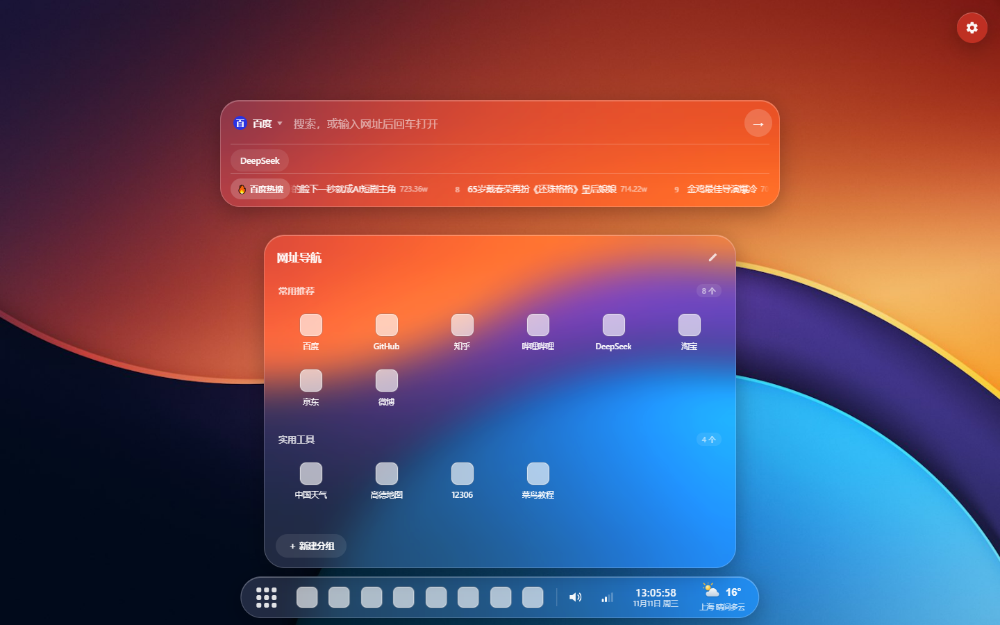

# Atrium Nav · 玻璃拟态网址导航

一个**单文件**的液态玻璃（Liquid Glass）风格浏览器起始页 / 网址导航页 —— `index.html` 一个文件装下全部逻辑，双击即用，无需安装、无需后端。

> 本项目的设计灵感与部分代码来自 [wynter-yaxley/atrium-desktop](https://github.com/wynter-yaxley/atrium-desktop)（C# 桌面玻璃美化项目），在此向原作者致谢 🙏 —— 本仓库将其玻璃视觉语言移植成了纯 Web 实现，并做了大量导航场景的适配。

## ✨ 功能

- **玻璃搜索框**：可切换/自定义搜索引擎（百度 / Bing / Google / 搜狗 / 360 / 哔哩哔哩内置）
- **搜索历史**：最多 9 条，支持单条删除、暂停与清空
- **直达网站**：快捷入口行，可自由增删（默认 DeepSeek）
- **百度热搜**：实时滚动热榜，悬停放大，明暗主题自适应
- **网址导航面板**：分组管理、跨分组移动、批量编辑、单条 Logo 自定义（自动抓取 favicon / 上传图片 / 首字兜底）、一键清除全部网址
- **图标本地落盘**（v1.5）：「一键获取 Logo」成功后自动转存为本地 PNG，离线可用、永不过期；首字图标同样生成一次 PNG 落盘，不再依赖外网
- **任务栏图标数量一键应用**（v1.5）：设置里的 ↻ 按钮即点即生效，不用回车
- **一键导入浏览器收藏夹**：支持 Chrome / Edge 的 `Bookmarks` 文件与导出的 `bookmarks.html`，自动识别浏览器并给出文件路径
- **任务栏**：访问量 Top-N 图标（数量可调）、悬停波浪放大（倍数可调）、音量/网络信号托盘图标（可开关）
- **时钟与天气**：秒级时钟 + 实时天气（Open-Meteo，自动定位，多源兜底）
- **日出日落图示**（v1.41）：悬停时钟弹出天弧图 —— 太阳按当前时刻沿弧线移动，昼蓝 `#3B82F6` / 夜黑 `#0B1026` 渐变背景随晨昏流动，含昼长与日出日落倒计时；日落后显示「当日日落 → 次日日出」夜弧与月相（v1.5.1）
- **设置面板滚动条**（v1.5.1）：滚动条收在圆角安全区内，不再上下出头
- **访问量角标开关**（v1.5.1）：设置里可显示/隐藏网址导航的访问量小徽章，默认关闭
- **热搜拖拽**（v1.5.2）：百度热搜跑马灯支持鼠标按住左右拖动，松手带惯性滑行、指数阻尼减速，停稳自动恢复滚动；轻点仍可直接打开新闻
- **热搜体验修补**（v1.5.3）：修复每圈回卷时的 15px 跳变卡顿（循环周期改按内容节点精确测量）；点「🔥百度热搜」标签直接新标签页打开热搜榜
- **昼夜按日出日落切换**（v1.5.3）：昼/夜不再按自然日切分 —— 抓取昨天/今天/明天三天日出日落，夜间段从日落连续覆盖到次日日出（自然跨过午夜），凌晨也能看到夜弧与月亮；背景渐变、倒计时、昼长同步按事件计算
- **热搜榜多选**（v1.5.4）：设置里可勾选最多 3 个热搜榜（百度 / 微博 / 抖音 / 今日头条 / 知乎 / B站 / 豆瓣 / 36氪·虎嗅 / 今日热榜），多榜合并滚动并带来源徽标；三镜像并行抓取，30 分钟自动刷新
- **热搜样式精修**（v1.5.4）：深色壁纸下标题提为纯白加粗；前三名序号改为白字红圆底徽标
- **一键获取全部 Logo**（v1.5.4）：分组编辑底部新增「⤓ 一键获取 Logo」，为整组没有 Logo / 首字图标的网址批量抓取（失败自动落首字图标）；自定义上传/粘贴的图标一律跳过，旧版 64×64 首字 PNG 也能识别重取
- **收藏夹获取支持 360 浏览器**（v1.5.4）：自动识别 360 极速（含极速X / 旧版）与 360 安全浏览器；任何浏览器打开都可在弹窗里复制 360 收藏夹路径或按指引导出 HTML
- **编辑不再丢改动**（v1.5.5）：编辑途中删除/上移/下移/移动网址时，行内已改但未保存的名称与网址会先收集再重排，不再被旧值覆盖；编辑中面板意外关闭也会自动保存
- **修复删除行闪退**（v1.5.5）：删除记录后面板不再整块关闭，改为原地减少一行继续编辑
- **分组排序**（v1.5.5）：分组可 ↑ ↓ 逐个换位；底部新增「⇅ 分组排序」，弹窗里按住拖动即可一次性调整全部分组顺序
- **组内拖动排序开关**（v1.5.5）：分组编辑底部新增「拖动排序」开关（默认关闭）；打开后网址行首出现 ⠿ 手柄，可按住在本组内自由拖动换位，松手即保存，跨组不生效
- **移到弹窗重制**（v1.5.5）：原生下拉改为玻璃风格弹层（显示各组网址数），点弹窗外部即关闭；滚动条与全局统一并收在圆角内
- **分组名称支持 8 个字**（v1.5.5）：编辑与新建分组均可输入最多 8 个字
- **分组标题更醒目**（v1.5.5）：分组标题字号增至 15px 并叠一层淡阴影，在彩色壁纸上更清晰易读；网址图标名不受影响
- **设置弹窗改为顶端滑下**（v1.5.6）：设置窗体从页面顶端中间缓缓滑落至屏幕居中（0.62 秒），落定带回弹（强度为全局弹性曲线的 2/3）
- **网址导航橡皮筋回弹**（v1.5.6）：分组面板滚到最顶/最底还继续滚动时，内容被拉动拉伸（阻尼上限 17px），停止滚动后弹回原位，iOS 式 overscroll 手感；普通滚动不受影响
- **设置面板同款橡皮筋**（v1.5.6）：设置窗体滚动也获得与导航面板完全一致的顶/底拉伸回弹手感
- **新建分组收进编辑态**（v1.5.6）：普通状态不再显示「＋ 新建分组」按钮，底部工具条整体仅编辑态显示；滚动条上下各收 26px 安全区，与面板圆角对称
- **修复上传 .ico 图标闪退**（v1.5.7）：原生文件对话框关闭瞬间的“幽灵点击”会误关编辑面板并丢失上传上下文，导致图片传不上；现已加对话框守卫拦截，并放行 .ico 等图片扩展名
- **日出日落面板夜间弧线修正**（v1.5.7）：月亮移动方向与标签时间流对齐（日落→下次日出，左→右）；已走过的弧线用实线表示（与日弧同款样式）；弧线在月亮处自动断开不再遮住月牙
- **网络状态面板**（v1.41）：悬停网络图标查看下行速度、往返延迟、公网 IP、运营商（三级 IP 源兜底）
- **缩放**：右上角 ±5% 缩放，支持自由输入（50–200%）
- **壁纸**：内置 4 张液态玻璃壁纸，支持纯色（HEX 直输 + 系统调色板）、上传图片、拖拽/粘贴
- **配置迁移**：一键导出/导入 JSON，跨电脑搬家不丢数据

## 🎬 功能演示

| 视频 | 内容 |
| --- | --- |
| [01 网址导航面板](docs/videos/01-nav-panel.webm) | 任务栏波浪放大、音量托盘、分组面板与图标悬停 |
| [02 设置与 ↻ 应用](docs/videos/02-settings-apply.webm) | 图标数量 6 ↔ 12 一键切换，即点即生效 |
| [03 日出日落与网络](docs/videos/03-clock-sun-net.webm) | 悬停时钟弹出天弧渐变图、悬停网络图标看实时参数 |
| [04 一键获取 Logo](docs/videos/04-icon-autoload.webm) | 编辑态 → 齿轮 → 自动抓取 Logo 并转存本地 |
| [05 搜索引擎切换](docs/videos/05-search-engine.webm) | 引擎菜单切换百度 / Bing / 哔哩哔哩，输入搜索词 |

## 🚀 使用

1. 下载 `index.html`，双击用 Chrome / Edge 打开即可
2. 首次打开自带 16 个常用网址起步包（v1.5），可随意增删改分组
3. 也可点「获取收藏夹网址」一键导入浏览器书签

在线版：**https://sylartsui.github.io/atrium-nav/**

## 📄 License

MIT —— 见 [LICENSE](LICENSE)。基于 [wynter-yaxley/atrium-desktop](https://github.com/wynter-yaxley/atrium-desktop)（MIT）。
